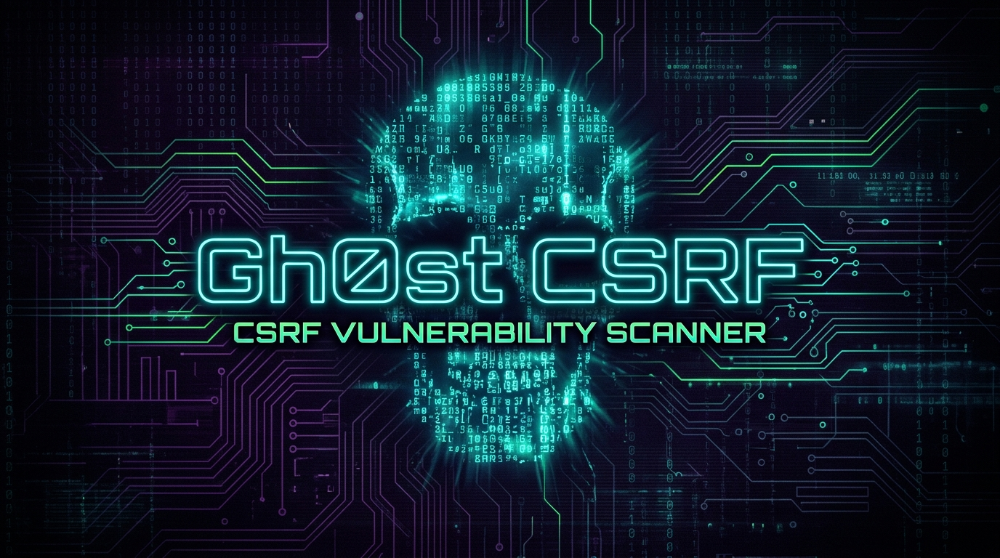

<div align="center">



<br><br>

[](https://python.org)
[](LICENSE)
[](https://github.com/0xgh0stri13y/Gh0st_CSRF)
[](https://github.com/0xgh0stri13y/Gh0st_CSRF/pulls)

<br>

<samp>

`🕷️ Crawl` · `🔍 Detect` · `🍪 Analyse` · `💣 Exploit`

</samp>

</div>

<br>

<!-- ━━━━━━━━━━━━━━━━━━━━━━━━━━━━━━━━━━━━━━━━━━━━━━━━━━━━━━━━ -->

##  &nbsp; Features

<table>
<tr>
<td width="50%">

### 🕷️ Concurrent Crawling
Multi-threaded page fetching with configurable worker count for **blazing-fast** scans

### 🔍 Smart CSRF Detection
Detects `csrf`, `xsrf`, `token`, `authenticity_token`, `csrfmiddlewaretoken` & more

### 🍪 Cookie Analysis
Reports `SameSite`, `Secure`, and `HttpOnly` flags on every cookie

### 📊 Report Export
Export to **JSON** or a styled **dark-theme HTML** report

</td>
<td width="50%">

### 📝 Deep Form Extraction
Parses `<input>`, `<textarea>`, and `<select>` inside every `<form>`

### 🛡️ Security Header Audit
Checks `X-Frame-Options`, `Content-Security-Policy`, and `Strict-Transport-Security`

### 💣 PoC Generator
Auto-generates self-submitting **HTML exploit** files for every vulnerable form

### 🔄 Retry & Timeout
3 automatic retries per page with 10s timeout and a realistic `User-Agent`

</td>
</tr>
</table>

<br>

<!-- ━━━━━━━━━━━━━━━━━━━━━━━━━━━━━━━━━━━━━━━━━━━━━━━━━━━━━━━━ -->

##  &nbsp; Installation

```bash
# Clone the repo
git clone https://github.com/0xgh0stri13y/Gh0st_CSRF.git
cd Gh0st_CSRF

# Install dependencies
pip install -r requirements.txt
```

> [!NOTE]
> Requires **Python 3.10** or higher.

<br>

<!-- ━━━━━━━━━━━━━━━━━━━━━━━━━━━━━━━━━━━━━━━━━━━━━━━━━━━━━━━━ -->

##  &nbsp; Usage

```bash
python gh0st.py -u <target_url> [options]
```

### ⚙️ Options

| Flag | Description | Default |
|:-----|:------------|:-------:|
| `-u`, `--url` | **Required.** Target URL to scan | — |
| `--depth` | Crawl depth (link-levels to follow) | `2` |
| `-o`, `--output` | Export report (`.json` or `.html`) | — |
| `--poc` | Generate PoC HTML files for vulnerable forms | `off` |
| `--threads` | Number of concurrent workers | `5` |

<br>

<!-- ━━━━━━━━━━━━━━━━━━━━━━━━━━━━━━━━━━━━━━━━━━━━━━━━━━━━━━━━ -->

##  &nbsp; Examples

<details>
<summary><b>🟢 Basic Scan</b></summary>
<br>

```bash
python gh0st.py -u https://example.com
```

</details>

<details>
<summary><b>🟡 Deep Scan + PoC + HTML Report</b></summary>
<br>

```bash
python gh0st.py -u https://example.com --depth 3 --poc -o report.html
```

</details>

<details>
<summary><b>🔴 Fast Scan (10 threads) + JSON Export</b></summary>
<br>

```bash
python gh0st.py -u https://example.com --threads 10 -o results.json
```

</details>

<br>

<!-- ━━━━━━━━━━━━━━━━━━━━━━━━━━━━━━━━━━━━━━━━━━━━━━━━━━━━━━━━ -->

##  &nbsp; What You Get

> [!IMPORTANT]
> The scanner produces a detailed breakdown of your target's CSRF posture:

| Result | What it tells you |
|:------:|:------------------|
| 🔴 **Vulnerable Forms** | Forms missing any CSRF token — action URL + HTTP method |
| 🟢 **Protected Forms** | Forms that already include a CSRF token |
| 🍪 **Cookie Flags** | `SameSite`, `Secure`, and `HttpOnly` status per cookie |
| 🛡️ **Security Headers** | Presence of `X-Frame-Options`, `CSP`, `HSTS` |

When `--poc` is enabled, self-submitting HTML files are saved to `poc_output/`.

<br>

<!-- ━━━━━━━━━━━━━━━━━━━━━━━━━━━━━━━━━━━━━━━━━━━━━━━━━━━━━━━━ -->

##  &nbsp; Contributing

Contributions, issues, and feature requests are welcome!
Feel free to check the [issues page](https://github.com/0xgh0stri13y/Gh0st_CSRF/issues).

## 📄 License

This project is licensed under the **MIT License** — see the [LICENSE](LICENSE) file for details.

> [!CAUTION]
> This tool is intended for **authorized security testing only**. Unauthorized use against systems you do not own or have permission to test is illegal.

---

<div align="center">

<br>

Made with ❤️ by **[Gh0st_ri13y](https://github.com/0xgh0stri13y)**

<br>


</div>
